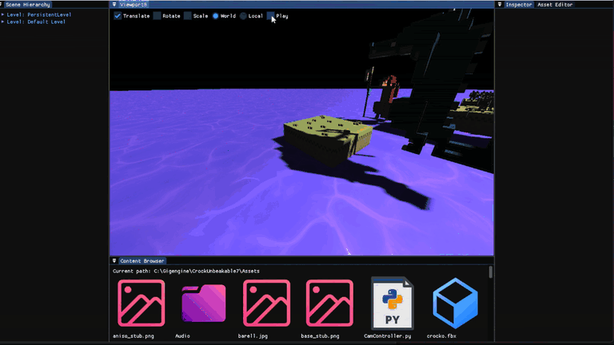
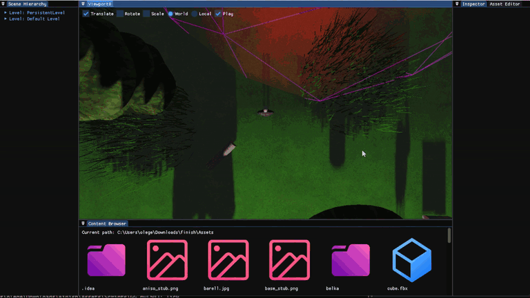

# GiiGaEngine

## Overview
This is an educational game engine developed in C++20 (we tried modules, but failed so it is header only now :]), designed to provide a Unity/Unreal-like editor experience. It features a "modern" rendering pipeline, an extensible asset system, a physics engine, and Python scripting support.

## Features
### Rendering
- Built using DirectX 12
- Supports point and directional lights
- Cascaded shadow mapping
- Deferred rendering pipeline
- ImGui-based editor GUI

### Asset System
- Uses Assimp for asset importing
- Supports mesh, material, and texture loading

### Physics
- Integrates Jolt Physics for collision and dynamics simulation

### Scripting
- Python scripting via Pybind11
- Allows mutating C++ objects from Python scripts
- Supports extending engine classes in Python

## Simple Games
The engine has been used to develop some simple games:
- Game by [Gamestus](https://github.com/Gamestus)

- Game by [mik5937](https://github.com/mik5937)

